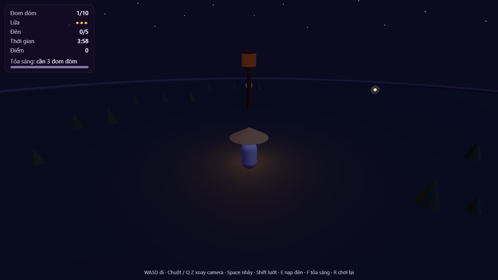
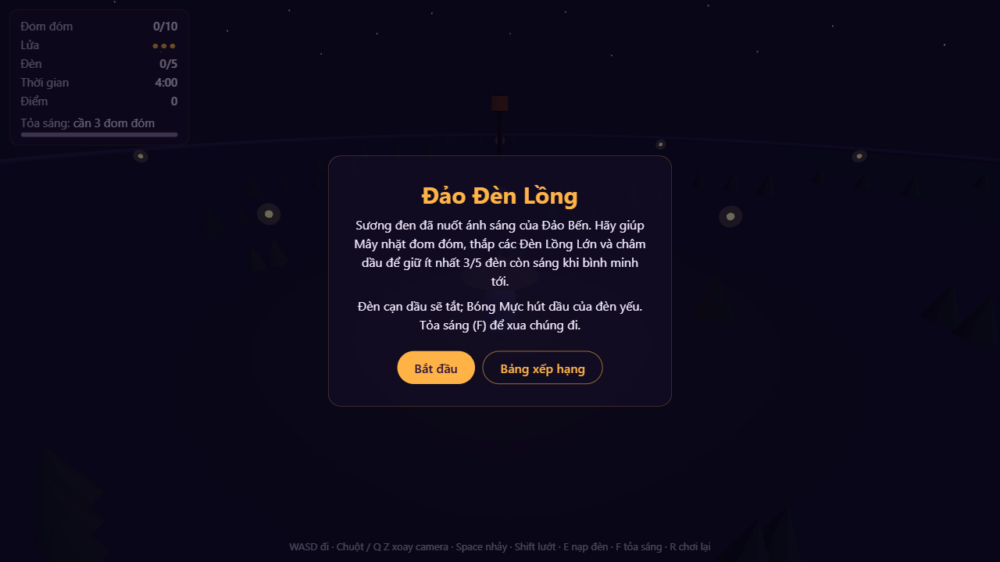
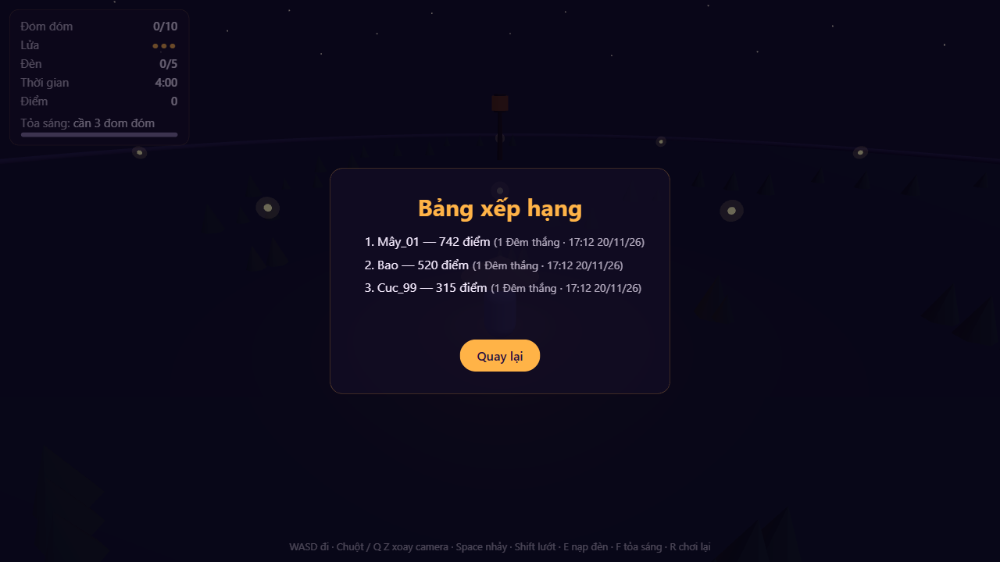
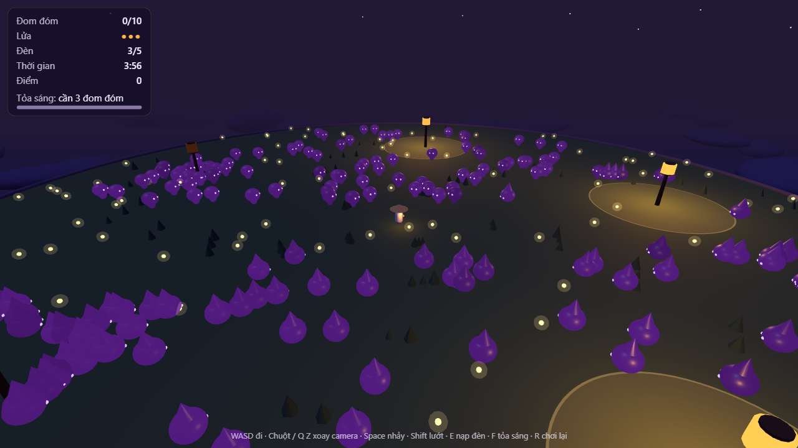

🎬 Video demo: https://github.com/Jennguyen106/K5-L3A-DAY12-NguyenThiHaiYen-2A202603567-AI-SDLC-Dao-Den-Long/releases/download/v1.0.0/demo.mp4

📦 Bản chạy được: xem [Release v1.0.0](https://github.com/Jennguyen106/K5-L3A-DAY12-NguyenThiHaiYen-2A202603567-AI-SDLC-Dao-Den-Long/releases/tag/v1.0.0)

# Đảo Đèn Lồng

Game 3D nhỏ chạy trên trình duyệt (Three.js). Bạn điều khiển **Mây**, người giữ đèn nhỏ tuổi của một hòn đảo giữa biển mây. Đêm nay sương đen nuốt mất ánh sáng: Mây phải nhặt đom đóm, thắp và châm dầu cho các Đèn Lồng Lớn, xua những Bóng Mực tím đen đang hút dầu, và **giữ đảo đủ sáng tới bình minh**.

Day 12 · AI SDLC Lab · Team `2A202603567-nguyen-thi-hai-yen` · Phiên bản **1.0.0** · Test Contract **v1.3**



| Menu chính | Bảng xếp hạng | Cảnh benchmark |
|---|---|---|
|  |  |  |

Ảnh chụp giao diện thật bằng Playwright ở 1280×720. Ảnh bảng xếp hạng dùng dữ liệu thử.

## Yêu cầu hệ thống

- **Node.js ≥ 18.** Đã thử trên Node 26.13.1, Windows 11. Code chỉ dùng `path`/`URL` nên chạy được trên macOS và Linux.
- **Trình duyệt** hỗ trợ WebGL2: Chrome/Edge/Firefox/Safari bản mới.
- Chỉ cần cho **bench**: Chromium của Playwright (`npx playwright install chromium`, khoảng 150 MB) và màn hình (bench mở cửa sổ thật).
- Không cần GPU rời. Bench tham khảo trên Ryzen 5 7530U với GPU tích hợp: khoảng 148 fps (xem phần [Benchmark](#benchmark)).

## Cài đặt và chạy (3 lệnh)

```bash
git clone https://github.com/Jennguyen106/K5-L3A-DAY12-NguyenThiHaiYen-2A202603567-AI-SDLC-Dao-Den-Long.git && cd K5-L3A-DAY12-NguyenThiHaiYen-2A202603567-AI-SDLC-Dao-Den-Long
npm install
npm start
```

Sau đó mở URL được in ra (mặc định `http://localhost:8080/`), bấm **Bắt đầu**. Cổng 8080 bận thì server tự thử cổng kế tiếp; muốn chọn cổng thì chạy `PORT=9000 npm start`.

Không muốn clone: tải `dao-den-long-web-v1.0.0.zip` ở GitHub Release, giải nén, chạy `node tools/serve.js` (không cần `npm install`).

## Điều khiển

| Phím | Hành động |
|---|---|
| W A S D (hoặc ↑ ↓) | Đi |
| Chuột (bấm vào màn hình để khóa chuột) hoặc Q / Z (← →) | Xoay camera |
| Space | Nhảy |
| Shift | Lướt (14 m/s trong 0.2 s, hồi chiêu 1.5 s) |
| E | Nạp đom đóm vào đèn gần nhất: thắp mới, thắp lại, hoặc châm dầu |
| F | Tỏa Sáng: xua Bóng Mực trong 5 m, tốn 3 đom đóm, hồi chiêu 3 s |
| R | Chơi lại |

## Luật chơi (Contract v1.2–v1.3)

- **Đom đóm:** đi tới gần (≤ 1 m) là tự nhặt. Sức chứa ban đầu 10, mỗi lần thắp thành công +2, tối đa 20.
- **Đèn:**
  - Thắp lần đầu cần 10 đom đóm. Đèn đã từng sáng mà tắt thì thắp lại chỉ cần 5.
  - Đèn sáng có **dầu** 0–100, hao 1/giây. Hết dầu thì đèn tắt.
  - Bấm E ở đèn đang sáng để **châm dầu**: mỗi đom đóm +10 dầu.
- **Vùng an toàn:** đèn sáng có dầu ≥ 30 tạo vùng 6 m mà Bóng Mực không vào được. Dầu dưới 30 là "đèn yếu", mất vùng an toàn.
- **Bóng Mực:**
  - Lang thang, đuổi Mây khi Mây trong 12 m. Chạm Mây thì Mây mất 1 Ngọn Lửa, rơi một nửa số đom đóm đang mang, và được bất tử 1.5 s.
  - Con đang lang thang sẽ tìm tới đèn yếu để **hút dầu** (5/giây).
- **Rơi khỏi đảo:** mất 1 Ngọn Lửa và toàn bộ đom đóm, hồi sinh sau 1 s.
- **Thắng/thua (chỉ xét ở bình minh):**
  - Hết giờ (Đêm 1 dài 240 s) mà còn Ngọn Lửa và **≥ 3/5 đèn đang sáng** → thắng (`dawn_survived`).
  - Hết giờ mà dưới 3 đèn → thua (`dawn`).
  - Hết 3 Ngọn Lửa → thua ngay (`no_flames`).

### Cách tính điểm

| Sự kiện | Điểm |
|---|---|
| Mỗi đom đóm nạp vào đèn (thắp, thắp lại, châm dầu) | +5 |
| Thắp đèn lần đầu | +100 |
| Thắp lại đèn đã tắt | +40 |
| Mỗi Bóng Mực trúng Tỏa Sáng | +5 (+15 nếu nó đang hút dầu) |
| Bình minh, chỉ khi thắng: mỗi đèn đang sáng | +50 + phần nguyên của dầu còn lại |
| Bình minh, chỉ khi thắng: mỗi Ngọn Lửa còn lại | +50 |

## Bảng xếp hạng

- Khi Đêm kết thúc, màn hình kết quả có ô **nhập tên** để lưu điểm.
  - Tên dài 3–12 ký tự, gồm chữ, số và `_`. Chữ tiếng Việt có dấu được chấp nhận; không dùng dấu cách.
  - Điểm lưu là **tổng điểm các Đêm đã thắng**. Giao diện hiện chơi một Đêm, nên thua thì lưu 0.
- Xem top 10 bằng nút **Bảng xếp hạng** ở menu chính hoặc màn hình kết quả. Xếp theo điểm giảm dần; bằng điểm thì ai đạt trước đứng trên.
- Dữ liệu lưu ở `data/leaderboard.json` qua API của `tools/serve.js`, nên vẫn còn sau khi tắt và mở lại game. Có thể đổi chỗ lưu bằng biến `LEADERBOARD_FILE`.
- Xuất ra file:

  ```bash
  npm start -- --export-leaderboard out.json     # → {"entries": [ … ]} đúng thứ tự
  ```

## Chạy test

```bash
npm test
```

70 test `node:test`. Phần lớn chạy headless thật trên các scenario trong `scenarios/`:

| Nhóm | File | Nội dung |
|---|---|---|
| Phase 1 | `tests/ac01…ac14-*.test.js` | Test Contract v1.0, di chuyển, nhặt, nạp đèn, tỏa sáng, bị chạm, thắng/thua |
| Phase 2 | `tests/p2-*.test.js` | Contract v1.1, lướt, rơi, đom đóm rơi, vùng an toàn, địa hình Đêm 2/3, hiệu năng headless |
| Phase 3 | `tests/p3-*.test.js` | Nhiên liệu, tắt/thắp lại, châm dầu, hút dầu, luật bình minh, sức chứa, điểm |
| Phase 4 | `tests/p4-*.test.js` | Contract v1.3, soak, công thức bench, cảnh bench, bảng xếp hạng, đóng gói |

Test cũ phải đổi vì luật mới thì có comment `[v1.1]`/`[v1.2]`/`[v1.3]` ghi lý do. Không test nào bị skip.

## Chế độ headless

```bash
node src/headless.js --seed 42 --night 1 --ticks 3000 --out out.jsonl
```

Tham số đầy đủ (Test Contract v1.3):

```
node src/headless.js --seed <int> --night 1|2|3 [--scenario <file.json>] [--inputs <file.json>]
                     --ticks <int> --out <file.jsonl> [--snapshot-every <int, mặc định 10>]
```

- Logic chạy cố định 60 tick/giây, tất định theo seed: cùng seed và cùng input cho output giống hệt.
- Mã thoát:
  - `0`: chạy xong.
  - `1`: tham số sai, không đọc được file, hoặc tính năng chưa cài.
  - `2`: file inputs/scenario sai định dạng.

## Benchmark

```bash
npx playwright install chromium        # một lần
node tools/bench.js --seed 42 --duration 30 --out bench.json
```

- Mở Chromium **có cửa sổ** 1280×720, tắt vsync (`--disable-gpu-vsync --disable-frame-rate-limit`), tới `index.html?bench=1&seed=42`.
- Cảnh chuẩn:
  - Đêm 1, 200 Bóng Mực lang thang, 100 đom đóm, đèn L1–L3 sáng với dầu 100.
  - Tắt: sinh thêm thực thể, sát thương, nhặt, hao dầu, kết thúc Đêm.
  - Camera bay vòng bán kính 30 m, cao 15 m, 15 s một vòng.
- 3 s đầu khởi động, sau đó đo đúng `--duration` giây.

Kết quả trên máy tự đo, chỉ để tham khảo ([`docs/proof/phase-4/bench.json`](docs/proof/phase-4/bench.json)):

| avg_fps | p1_low_fps | frame_ms_p95 | load_ms | Máy |
|---|---|---|---|---|
| 148.1 | 76.1 | 10.3 | 2062 | Ryzen 5 7530U, Radeon tích hợp, Windows 11 |

**`peak_mem_mb` = `null`:** đây là bản web. Playwright không cho đo RSS của các tiến trình Chromium theo cách chạy được trên mọi hệ điều hành. Thay vào đó, `bench.json` ghi `js_heap_peak_mb` (JS heap đỉnh của trang, lấy qua Chrome DevTools Protocol).

## Soak test

```bash
node --expose-gc src/soak.js --seed 7 --nights 10 --out soak.json
```

- Chạy 10 Đêm liên tiếp trong cùng tiến trình, xoay vòng Đêm 1 → 2 → 3, Đêm thứ i dùng seed 7 + i.
- Input ngẫu nhiên theo seed: mỗi 30 tick đổi hướng; mỗi tick 5% nhảy, 3% lướt, 2% tỏa sáng, 10% tương tác.
- Đạt khi `crashes = 0` và `mem_end_mb ≤ 1.2 × mem_start_mb`.

Kết quả ([`docs/proof/phase-4/soak.json`](docs/proof/phase-4/soak.json)): crashes 0, RSS 46.8 → 53.6 MB (×1.145).

## Đóng gói bản phát hành

```bash
npm run dist
```

Lệnh tạo `dist/dao-den-long-web-v1.0.0/` và `dist/dao-den-long-web-v1.0.0.zip`. Gói gồm thư mục web tĩnh, `tools/serve.js` và three.js, chạy bằng `node tools/serve.js` mà không cần `npm install`. Zip được ghi bằng `zlib` của Node, không dùng thư viện ngoài.

## Tuning (`game.contract.json`, v1.3)

Game đọc trực tiếp khối `tuning` (qua `createConfig` trong `src/logic/config.js`), nên số khai báo cũng chính là số game dùng. Độ dài tính bằng mét, đo trên mặt phẳng XZ.

| Khóa | Giá trị | Ý nghĩa |
|---|---|---|
| `player_speed` | 6 | Tốc độ chạy (m/s) |
| `carry_capacity` / `capacity_max` | 10 / 20 | Sức chứa ban đầu / tối đa (+2 mỗi lần thắp thành công) |
| `lantern_cost` / `relight_cost` | 10 / 5 | Đom đóm để thắp lần đầu / thắp lại |
| `lantern_count_night1` | 5 | Số đèn Đêm 1 |
| `pickup_radius` / `interact_radius` | 1.0 / 2.0 | Bán kính nhặt / nạp đèn |
| `pulse_cost` / `pulse_radius` / `pulse_cooldown_s` | 3 / 5 / 3 | Tỏa Sáng: chi phí, bán kính (3D, tâm cao 0.8 m), hồi chiêu |
| `pulse_stun_s` / `pulse_push_m` | 2 / 4 | Thời gian choáng / khoảng đẩy lùi |
| `night1/2/3_duration_s` | 240 / 270 / 300 | Thời lượng Đêm |
| `flames` / `invuln_s` / `hit_drop_ratio` | 3 / 1.5 / 0.5 | Ngọn Lửa / bất tử sau khi bị chạm / tỉ lệ đom đóm rơi |
| `safe_radius` / `low_fuel_threshold` | 6 / 30 | Vùng an toàn quanh đèn có dầu ≥ 30 |
| `shade_speed` / `shade_hit_radius` | 4.0 / 1.0 | Bóng Mực (Đêm 3: 4.5 m/s) |
| `fall_enabled` | true | Rơi khỏi đảo (Y < −10) bị phạt |
| `dash_speed` / `dash_duration_s` / `dash_cooldown_s` | 14 / 0.2 / 1.5 | Lướt |
| `fuel_max` / `fuel_decay_per_s` / `fuel_per_mote` / `drain_per_s` | 100 / 1.0 / 10 / 5 | Dầu đèn |
| `win_ratio` | 0.6 | Cần ≥ ceil(0.6 × số đèn) đèn sáng lúc bình minh |
| `score.*` | xem bảng điểm | `per_second_left` = 0 (đã bỏ thưởng thời gian) |

## Cấu trúc

- `src/logic/`: luật game thuần JS, tất định (`mulberry32`), không đồ họa. Game, headless, soak và bench dùng chung.
- `src/render/`: hiển thị 3D (Three.js), HUD, điều khiển, bảng xếp hạng, chế độ bench.
- `src/headless.js`, `src/soak.js`, `src/bench-stats.js`, `src/leaderboard.js`.
- `tools/serve.js` (server tĩnh + API bảng xếp hạng), `tools/bench.js`, `tools/dist.js`.
- `scenarios/`, `tests/`: tình huống và test.
- `docs/requirements/`: PRD và các ticket. `docs/notes/`: spec từng phase, nhật ký AI. `docs/adr/`: quyết định thiết kế. `docs/proof/`: bằng chứng từng phase.
- Harness AI: `AGENTS.md` (`CLAUDE.md` trỏ tới), skill `.claude/skills/verify/SKILL.md`.

## Sáng tạo của tôi

Phần thêm đều nằm ở hiển thị, không đổi luật hay output headless:

- Chiếc đèn nhỏ treo trên nón lá của Mây sáng dần theo số đom đóm đang mang.
- Bầu trời và mặt đảo ấm dần lên theo số đèn đã thắp.
- Bóng Mực run và chuyển xám khi bị choáng.
- Vòng sáng lan ra khi Tỏa Sáng.

Bằng chứng phần cũ vẫn đúng: toàn bộ test Phase 1–4 xanh.

## Giới hạn đã biết

- Giao diện mới chơi được **Đêm 1**. Đêm 2 và Đêm 3 hiện có trong logic/headless/soak (địa hình, đèn, Bóng Mực) nhưng chưa có trong giao diện.
- **Chưa cài:** Gió Lạc, Bùa Gió, gió mạnh Đêm 3, menu chuỗi 3 Đêm, tạm dừng và cài đặt trên giao diện, thanh dầu trên đèn, chế độ mù màu, đổi phím và các tùy chọn tiếp cận (TICKET-04 mục 4), **âm thanh**.
- `peak_mem_mb` của bench là `null` (xem trên).

## Giấy phép

Mã nguồn theo giấy phép [MIT](LICENSE). Thư viện và công cụ bên thứ ba: xem [CREDITS.md](CREDITS.md).
